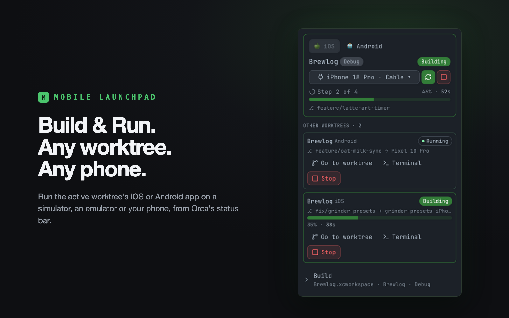
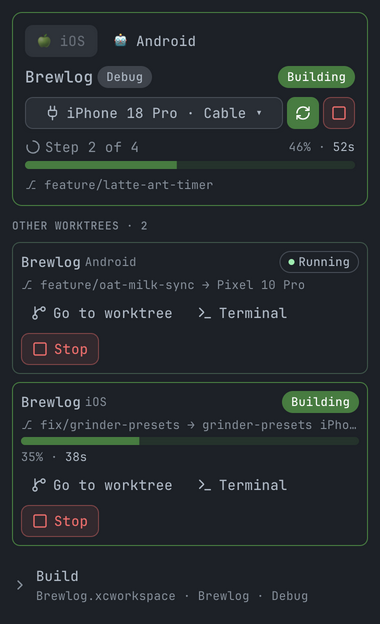
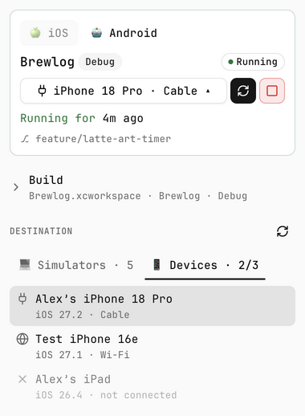
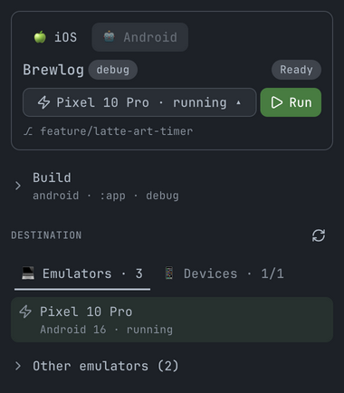
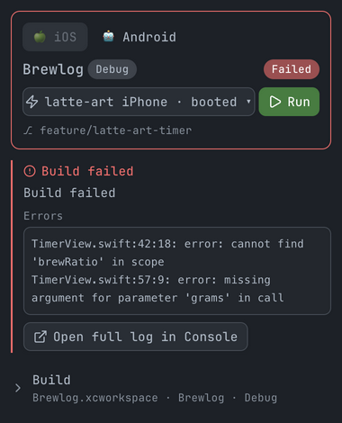

<p align="center">
  <a href="#installation"></a>
  <a href="#installation"></a>
  <a href="#requirements"></a>
  <a href="#contributing"></a>
  <a href="#license"></a>
</p>

# Mobile Launchpad

**Build & Run. Any worktree. Any phone.**

Run a few coding agents at once on a mobile app and every branch needs trying
on a device. Opening Xcode or Android Studio for each worktree, picking the
scheme, the simulator, waiting for the build: that's the slow part now.

Mobile Launchpad builds and runs the active worktree's iOS or Android app from
Orca's status bar, on a simulator, an emulator or your phone, by cable or
Wi-Fi. Each worktree remembers its own settings, runs in other worktrees stay
in sight, and agents can run the app too with one command. Built around
"one task = one worktree = one session".

Let's get back to work 🙂

<p align="center">
  <a href="#features">🌟 Features</a> ·
  <a href="#installation">📲 Installation</a> ·
  <a href="#usage">🐒 Usage</a> ·
  <a href="#launchpad-command">🤖 For agents</a> ·
  <a href="#how-it-works">🔍 How it works</a> ·
  <a href="#permissions">🔒 Permissions</a> ·
  <a href="#contributing">❤️ Contributing</a>
</p>

<p align="center">
  
  
  
</p>

<a name="features"></a>

## 🌟 Features

- 🚀 **One click from the status bar:** `🚀 Brewlog · iPhone 18 Pro`. While it builds it shows the step and progress, turns green when the app runs and red when it fails.
- 🍏🤖 **iOS and Android:** Xcode workspaces and projects, and Gradle builds. A worktree with both apps gets an iOS · Android switch.
- 📱 **Simulators, emulators and phones:** iPhones and Android phones by cable or Wi-Fi. Plug one in and it shows up on its own.
- 🌳 **Settings per worktree:** scheme or app module, configuration or build variant, and destination.
- 🧪 **A simulator per worktree:** "Simulator for this worktree" creates `<worktree> iPhone`, so several branches run side by side.
- 👀 **Runs in other worktrees:** their progress, failure or crash, with Stop, Go to worktree and Terminal.
- 🧯 **Failures you can read:** the build errors and, after a crash, the exception and the crashed thread.
- 🤖 **For agents:** `launchpad run` builds and runs from any terminal and exits with the result.
- 🎨 **Native look:** built with Orca's own components, light and dark.

<a name="requirements"></a>

## 🧰 Requirements

- **macOS** with **Orca 1.4.259** or later.
- **iOS:** Xcode and its command line tools. [`xcbeautify`](https://github.com/cpisciotta/xcbeautify) is used when installed.
- **Android:** the Android SDK (Android Studio installs it). The SDK is found through `ANDROID_HOME`, `ANDROID_SDK_ROOT` or `~/Library/Android/sdk`, and Gradle uses Android Studio's JDK when `JAVA_HOME` isn't set.

<a name="installation"></a>

## 📲 Installation

```sh
orca plugin install Juanpe/orca-mobile-launchpad
```

Orca shows what the plugin can do and asks you to re-run the command with
`--approve <fingerprint>`. [What it asks for and why →](#permissions)

Then open the panel:

```sh
orca plugin open juanpe.mobile-launchpad --panel launchpad
```

Releases follow [Semantic Versioning](https://semver.org/spec/v2.0.0.html);
Orca installs the newest `vX.Y.Z` tag. Update with `orca plugin update juanpe.mobile-launchpad`.

<a name="usage"></a>

## 🐒 Usage

Open a worktree with a mobile app and click **🚀** in the status bar, or press
`Mod+Alt+R`. The status bar item only shows up in worktrees with an app (an
Xcode project or a Gradle build at the root or in `ios/`, `android/`, `app/`,
`mobile/`…).

The panel has three parts:

| Part | What you get |
| --- | --- |
| 🚀 **Launch card** | The app, the destination chip, Run or Relaunch and Stop, progress and elapsed time |
| 🛠 **Build** | Project, scheme or app module, configuration or build variant |
| 📍 **Destination** | 💻 **Simulators** (or **Emulators**) and 📱 **Devices**, the selected one highlighted |

- **Click the destination chip** → opens or closes the picker. Picking one closes it again.
- **Run while it runs** → relaunches: stops the previous run and builds again.
- **Stop** → ends the build, or the app it launched.
- **Terminal** → shows the run's output. Closing that terminal doesn't stop the run.
- **Command palette** → `Mobile Launchpad: Build & Run` and `Mobile Launchpad: Stop`.

<p align="center">
  
</p>

> 💡 Runs live outside the terminal and outside the panel: switch worktrees,
> close the terminal or reload the plugin, and the run carries on.

<a name="launchpad-command"></a>

## 🤖 `launchpad` command (for agents)

The plugin writes a `launchpad` command so an agent, or a script, can run the
app of the worktree it works in. The run shows up in the panel and the status
bar, with the worktree's saved settings.

```sh
launchpad run                        # waits until the app runs; exit 0, or 1 with the build errors
launchpad run --device               # on the first connected phone (--device "18 Pro" to pick one)
launchpad run --simulator            # on a simulator or emulator, a running one first
launchpad run --android              # the Android app, when the worktree has both
launchpad run --configuration Release --follow   # print the build output as it goes
launchpad status | stop | devices
```

| Exit code | Meaning |
| --- | --- |
| `0` | The app is running, or ran and exited |
| `1` | The build or the launch failed (the errors are printed) |
| `2` | The app crashed |
| `3` | Orca or the plugin isn't reachable |
| `4` | Bad usage |
| `130` | Stopped |

The command lives in `$TMPDIR/orca-launchpad/launchpad` and is rewritten each
time the plugin starts. Put it on your `PATH` once:

```sh
ln -sf "$TMPDIR/orca-launchpad/launchpad" ~/.local/bin/launchpad
```

A line for an agent's skill: *To try the app, run `launchpad run` (add
`--device` for the phone). If it exits 1, fix the build errors it prints and
run it again.*

<a name="how-it-works"></a>

## 🔍 How it works

- **Finding the app:** an `.xcworkspace` or `.xcodeproj`, or a Gradle build
  with a module that applies `com.android.application`, at the root or in a
  conventional mobile folder. A folder that only holds other repositories
  doesn't count.
- **A run** is a script in its own process group, apart from any terminal.
  It writes its step to a status file the worker reads every second, and its
  output to a file an Orca terminal follows.
- **iOS:** boots the simulator (and shows it in Orca's emulator pane),
  `xcodebuild build` with Xcode's own DerivedData, so it shares Xcode's build
  cache, then installs and launches with `simctl` or `devicectl`, with the
  app's console in the terminal.
- **Android:** starts the AVD and waits for it to boot,
  `./gradlew :app:assemble<Variant>`, `adb install`, launches the launcher
  activity and prints the app's `logcat`. A crash in logcat's crash buffer
  marks the run as crashed.
- **Stop** ends the script's process group: the build, or the app.
- **Runs are kept** in the plugin's storage, so a reload picks them up again.
- **The `launchpad` command** talks to the plugin through files in
  `$TMPDIR/orca-launchpad/requests`, a folder only your user can read.

<a name="permissions"></a>

## 🔒 Permissions

| Access | Why |
| --- | --- |
| `trusted-worker` | Its own Node process, to run `xcodebuild`, `simctl`, `devicectl`, `gradlew` and `adb` |
| `workspace:read` | Know the active worktree and find its app |
| `workspace:write` | Only `workspace.open` and `terminal.focus`, for Go to worktree and Terminal |
| `terminal:send` | Open the terminal that follows a run, and close it on the next run |
| `notifications:show` | Tell you when the app is running, or the build failed or the app crashed |
| `storage:own` | Each worktree's settings, the runs and build times, in the plugin's own folder |

Mobile Launchpad changes nothing in your projects: builds go to Xcode's
DerivedData and Gradle's `build/` folders. Disable it with
`orca plugin disable juanpe.mobile-launchpad`, or remove it with
`orca plugin uninstall juanpe.mobile-launchpad`, which also deletes its folder.

<a name="contributing"></a>

## ❤️ Contributing

Found a bug? Want another platform? I'd love to hear about it.

- [Open an issue](https://github.com/Juanpe/orca-mobile-launchpad/issues) with a screenshot.
- Suggest an improvement or send a pull request.

To work on it, load this folder as a development plugin:

```sh
orca plugin dev watch . --check --shot .orca/shots   # load and reload on save
orca plugin test . --json                             # src/**/*.test.ts(x)
orca plugin check . --json                            # renders every scenario in src/panel.check.ts
orca plugin shot . --scenario showcaseBuilding --theme dark --width 380 --out assets/building-dark.png
npx -p typescript tsc -p .                            # types (after `orca plugin types .`)
```

The screenshots in `assets/` come from the `showcase*` scenarios in
`src/panel.check.ts`, with made-up data (a scenario shot needs Orca's window
hidden or minimized).

| File | What it does |
| --- | --- |
| `src/worker.ts` | Per-worktree state, status bar, commands, panel requests and the `launchpad` inbox |
| `src/panel.tsx` | The panel (Orca components, no build step) |
| `src/platforms/index.ts` | Picks the iOS or Android adapter by the project's platform |
| `src/platforms/ios.ts`, `ios-parse.ts` | The iOS adapter and its parsers (`simctl`, `devicectl`, `xcodebuild`, crash reports) |
| `src/platforms/android.ts`, `android-parse.ts` | The Android adapter and its parsers (`adb`, Gradle, logcat) |
| `src/platforms/runner.ts` | Starts a run script in its own process group and follows its output |
| `src/cli.ts` | The `launchpad` command |

When you're done, `orca plugin dev unload .` removes the development copy.

## 👨🏻‍💻 Author

Made by [Juanpe Catalán](https://github.com/Juanpe).

<a name="license"></a>

## 👮🏻 License

Mobile Launchpad is available under the [MIT license](LICENSE).
